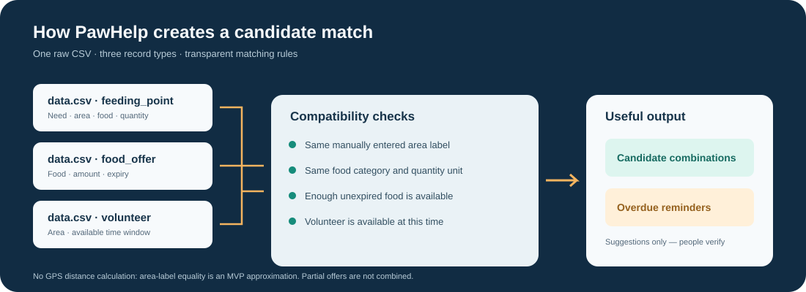

<div align="center">

# 🐾 PawHelp
### Community Animal Care & Feeding Coordination

**A lightweight local coordination board for community dogs, cats, cows and other animals — connecting observed needs, confirmed food offers and willing helpers.**

   

</div>

---

## 1. The problem

Community animals are visible around everyday places: hostels, cafeterias, parks, campus roads, school/college surroundings and garbage collection points. But sightings, feeding activity, food availability and volunteer time are often known by different people.

A person may notice animals near a place, another person may be willing to help, and someone else may have food — yet these pieces of information are not necessarily connected.

PawHelp is a small attempt to make local information easier to record and coordinate. It is not an animal rescue service, veterinary platform or guarantee that an animal will be fed.

## 2. Who it is for

- **Local feeders:** record a feeding point and its last confirmed visit.
- **Food contributors:** record a real food offer, amount and expiry.
- **Volunteers:** record when they are genuinely available.
- **Community members:** report an animal sighting that may need follow-up.

Use broad area labels (for example, “hostel area” or “nearby park”), not private home addresses. Use a person's name or alias only with permission.

## 3. Initial observations

The first entries below are based only on the locations and sightings described by the project owner. They are deliberately marked **unverified**. No dates, times, animal counts, feeder identities, food quantities or volunteer commitments have been invented.

| Area described | Animal / behaviour reported | What still needs checking |
|---|---|---|
| Nescafe area | Dogs approach when they see food | Date, time, count, whether anyone feeds them regularly |
| Cafeteria area | Dogs are around the cafeteria/food area | Date, time, count, feeder confirmation |
| Hostel area | Cats are present | Date, time, approximate count |
| Nearby parks | Dogs are seen in some parks | Which park, date, time, approximate count |
| School/college roads | Community animals are seen nearby | Species, exact public area, date and count |
| Roadside garbage areas | Dogs are seen near garbage | Date, time, count and local safety context |
| Nearby streets | Cows and calves are seen | Date, time and approximate count |
| Nearby streets | Cats roam around | Date, time and approximate count |

These eight preliminary reports are stored in `backend/data.csv` as `observation` rows. They are not eight verified feeding points, and they do not satisfy a requirement for 20 first-hand fieldwork records. The app's operational counts intentionally exclude these sightings.

## 4. Product workflow


**Step 1 — Observe and record.** A community member records an animal sighting using a broad area label. A sighting is a lead for follow-up, not proof of hunger or a confirmed feeding need.

**Step 2 — Confirm a feeding point.** A feeder confirms the place, food category, quantity/need, last visit and expected check-in interval. Only confirmed details should become a `feeding_point` record.

**Step 3 — Record a food offer.** A contributor enters the actual food category, quantity, unit and expiry. Food suitability must be confirmed by an experienced local feeder; PawHelp does not recommend diets.

**Step 4 — Record volunteer availability.** A volunteer enters a real time window and broad area. Availability should be short-lived and updated when plans change.

**Step 5 — Review suggested matches.** The app checks area, food type, quantity, expiry and volunteer availability. People must contact each other and confirm the plan outside the app.

**Step 6 — Confirm what happened.** The feeder or volunteer should verify the visit/delivery. A generated suggestion is not evidence that food was delivered or eaten.

## 5. Matching logic



A candidate match is produced only when all of these conditions hold:

1. Feeding point status is active.
2. Food offer status is available and its expiry is in the future.
3. Area labels match (case-insensitive exact text match).
4. Food category matches.
5. Quantity units match.
6. Offered quantity is at least the recorded quantity/need.
7. Volunteer status is available, the current time is within their availability window, and their area label matches.

The current implementation does not combine partial offers, estimate walking distance, use GPS, reserve food, send notifications, assign tasks, or confirm delivery. An overdue check-in is calculated from the feeder-entered last visit and interval; it is only a reminder to verify, not proof that a visit was missed.

## 6. Data model

All records are stored in the inspectable `backend/data.csv`.

| Record type | Purpose | Required real-world confirmation |
|---|---|---|
| `observation` | Preliminary animal sighting | What was seen, where and when |
| `feeding_point` | A known feeding point / need | Feeder confirms the point, food type, quantity and last visit |
| `food_offer` | Food that someone genuinely offers | Contributor confirms type, quantity and expiry |
| `volunteer` | A helper's time window | Volunteer confirms availability |

The initial eight `observation` rows are marked `unverified`; blank timestamps/counts are intentional. The React app's matching engine uses the three coordination record types, not unverified sightings. Do not convert an animal sighting into a food need, donor offer or volunteer record without confirmation.

### CSV columns

- `record_type`, `record_id`: record category and unique identifier.
- `recorded_at`: when the record was entered.
- `area_label`: broad local area, never a private address.
- `food_type`, `quantity`, `quantity_unit`: food need/offer details.
- `last_confirmed_visit`, `visit_interval_hours`: feeding-point check-in details.
- `available_from`, `available_until`: volunteer time window.
- `valid_until`: food offer expiry.
- `person_alias`: consented name/alias or a generic reporter label.
- `status`, `notes`: current state and context.

## 7. Application screens

- **Overview:** summary counts, check-ins to review and possible matches.
- **Feeding points:** active and paused feeding-point records.
- **Food offers:** available and withdrawn offers.
- **Volunteers:** available and unavailable time windows.
- **Match suggestions:** candidate combinations that meet all current rules.
- **Add a record:** form for adding a confirmed feeding point, food offer or volunteer.

The overview count for coordination records excludes preliminary `observation` rows so sightings are not misrepresented as confirmed feeding activity.

## 8. Architecture

```text
Browser (React + Vite)
        |
        | HTTP / JSON
        v
Node.js + Express API
        |
        +---- GET  /api/health
        +---- GET  /api/dashboard
        +---- POST /api/records
        |
        v
backend/data.csv
        |
        +---- validation.js
        +---- matching.js
```

- **Frontend:** React components and CSS provide the dashboard, tabs and record form.
- **API:** Express exposes health, dashboard and record-creation endpoints.
- **Storage:** CSV keeps the small dataset readable and easy to inspect for this MVP.
- **Validation:** required fields, positive quantities, valid dates and status values are checked before a coordination record is saved.
- **Matching:** deterministic rule-based matching; no AI model or external animal data API is used.

## 9. Technology stack

| Layer | Technology |
|---|---|
| Frontend | React |
| Development server / bundler | Vite |
| Backend | Node.js, Express |
| CSV parsing and writing | csv-parse, csv-stringify |
| Tests | Node.js built-in test runner |
| Version control | Git and GitHub |

## 10. Run locally

**Prerequisite:** Node.js 18+ and npm.

```bash
git clone https://github.com/AshaSaini-033/PawHelp.git
cd PawHelp
npm install
npm run dev
```

Open the Vite URL printed in the terminal (usually `http://localhost:5173`). The API runs on `http://localhost:4000`.

Production build:

```bash
npm run build
NODE_ENV=production npm start
```

Run tests:

```bash
npm test
```

## 11. API reference

| Method | Endpoint | Behaviour |
|---|---|---|
| GET | `/api/health` | Returns API health status |
| GET | `/api/dashboard` | Returns counts, feeding points, offers, volunteers, overdue points and candidate matches |
| POST | `/api/records` | Validates and appends a coordination record to the CSV |

Example request shape for a feeding point (replace all values with a real, confirmed record):

```json
{
  "record_type": "feeding_point",
  "area_label": "broad public area label",
  "food_type": "feeder-confirmed food category",
  "quantity": "1",
  "quantity_unit": "kg",
  "last_confirmed_visit": "2026-11-22 09:00",
  "visit_interval_hours": "24",
  "person_alias": "consented alias",
  "status": "active",
  "notes": "Confirmation context; no private contact details"
}
```

## 12. Tests

The test suite covers matching compatibility and failure cases, including area mismatch, insufficient quantity, expired offers, unavailable volunteers, overdue reminders and invalid quantities. Run `npm test` before submission.

## 13. Safety, privacy and limitations

- A sighting does not prove that an animal is hungry or needs feeding.
- Only record food that an experienced local feeder confirms is suitable.
- Do not provide veterinary advice or attempt treatment based on this app.
- Do not feed spoiled food or place food where it creates road/public safety hazards.
- Do not publish private addresses, phone numbers or personal information.
- Respect campus/school rules, local permissions and residents.
- A match is a suggestion, not an assignment or proof of delivery.
- If no volunteer is available, the need remains unresolved.
- Stale, duplicate or incorrect records must be checked with the contributor.
- CSV is suitable for a small prototype, not concurrent large-scale production use.
- No authentication or role-based access control is implemented yet.

## 14. Scope decisions

**Included:** CSV-based record keeping, validation, overdue check-in calculation, transparent rule-based suggestions and a small React dashboard.

**Not included:** GPS tracking, maps, chat, push notifications, payments, rescue dispatch, veterinary triage, diet recommendations, automatic proof of delivery, AI image recognition or combining partial food offers.

These exclusions keep the first version small enough to test with one local community.

## 15. Fieldwork still required

The current initial sightings are preliminary user-reported notes only. Before treating PawHelp as a field-tested solution:

- [ ] Visit the selected public locations and note date, time and approximate animal counts.
- [ ] Speak to at least one named feeder/coordinator (with consent) and record their role and exact relevant statements.
- [ ] Ask what coordination problem they actually face and whether this tool would help.
- [ ] Collect the assignment-required 20+ real records; do not generate, download or infer them.
- [ ] Capture two timestamped field photos only with appropriate permission and without exposing private information.
- [ ] Update `research.md`, `fieldwork.md` and `reflection.md` using your own work.
- [ ] Record the required three-minute screen demo and link it here.
- [ ] Include actual AI chat exports if required; summary notes are not verbatim chat transcripts.

## 16. Repository layout

```text
PawHelp/
├── backend/
│   ├── data.csv
│   ├── server.js
│   ├── matching.js
│   └── validation.js
├── frontend/src/
│   ├── App.jsx
│   ├── main.jsx
│   └── style.css
├── fieldwork/
│   └── initial-observations.csv
├── docs/images/
│   ├── workflow.svg
│   └── matching-logic.svg
├── evidence/
├── ai-chats/
├── tests/
├── package.json
└── README.md
```

---

<div align="center">

**PawHelp — small local actions, better community coordination. 🐾**

</div>
