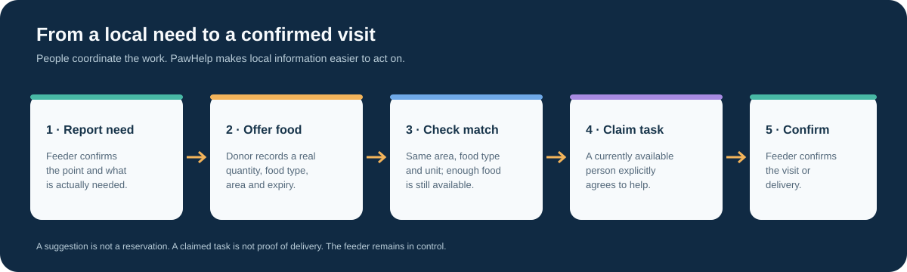

# 🐾 PawHelp
### A local community-dog feeding coordination tool

PawHelp helps a small local community coordinate **safe food contributions, available volunteers, and recurring feeding-point visits** for community dogs.

> **The problem we are testing:** food offers, feeding needs, and volunteer availability may be scattered across conversations. A feeder can have difficulty knowing which nearby point needs help and whether anyone has accepted the task. PawHelp brings those updates into one simple workflow.

**Important:** This is a coordination aid, not an animal-rescue service, veterinary tool, or guarantee that a feeding request will be fulfilled.

---

## ✨ What the MVP does

- **Feeding points:** record a locally observed feeding location and its visit status.
- **Food offers:** record food type, quantity, safe-use note, and donor contact/alias.
- **Volunteer commitments:** let an available volunteer claim an open task.
- **Nearby matching:** rank candidate offers/tasks using the local area and compatibility fields supplied by the user.
- **Visit tracking:** move a task through open → claimed → delivered → confirmed.
- **Overdue visibility:** highlight feeding points whose next check is due or whose last visit is not confirmed.
- **Data quality checks:** reject malformed rows and flag incomplete or inconsistent entries instead of silently treating them as facts.

## 🧭 How it works



1. A feeder or coordinator reports a real feeding-point need.
2. A donor records a suitable food contribution, or a volunteer records availability.
3. PawHelp shows compatible open tasks and possible matches.
4. A volunteer explicitly claims a task. An unclaimed task stays open.
5. The feeder/coordinator confirms the visit or delivery. Only then is it marked confirmed.

## 🖥️ Screenshots

> Add genuine screenshots of the running application here after you run it. Do not use mockups as proof of a working feature.

| Dashboard | Match details |
|---|---|
|  |  |

## 🧱 Tech stack

- **Python** for the small matching and data-validation service
- **CSV** for transparent, locally collected MVP data
- **React** for the user interface (planned app layer)
- **Node.js / Express** for an API layer when the workflow is validated

The first deliverable prioritises a working data-driven workflow over unnecessary infrastructure. No external dataset, animal-recognition model, payment gateway, or map API is required.

## 🚀 Run locally

The data/matching MVP lives in `backend/`.

```bash
cd backend
python -m venv .venv
```

Activate the environment:

**Windows PowerShell**
```powershell
.venv\Scripts\Activate.ps1
```

**macOS / Linux**
```bash
source .venv/bin/activate
```

Install dependencies and start:

```bash
pip install -r requirements.txt
streamlit run app.py
```

The app reads `data/feeding_points.csv`, `data/food_offers.csv`, and `data/volunteers.csv`. Replace the starter headers with your own verified records before using it for a real local workflow.

## 📁 Repository structure

```text
PawHelp/
├── backend/
│   ├── app.py
│   ├── matching.py
│   ├── data_validation.py
│   ├── requirements.txt
│   └── data/
│       ├── feeding_points.csv
│       ├── food_offers.csv
│       └── volunteers.csv
├── docs/
│   └── images/
├── research.md
├── fieldwork.md
├── reflection.md
├── ai-chats/
└── README.md
```

## 📍 Fieldwork and data integrity

This project is being developed for a one-day, real-world take-home assignment. The project must be grounded in a place visited by the developer and a conversation with one real person who is not the developer.

- **Area visited:** _Fill in after the visit_
- **Date and time:** _Fill in from actual field notes_
- **Person helped:** _Name and role, with their permission_
- **Data:** at least 20 real entries collected first-hand
- **Evidence:** two timestamped photographs, stored only with appropriate permission

The repository intentionally does **not** contain fabricated observations, names, interview quotes, photos, or sample measurements. Keep identifying details private when consent is not available; do not publish anyone's phone number or exact sensitive location.

See [research.md](research.md), [fieldwork.md](fieldwork.md), and the CSV collection notes.

## 🛡️ Safety, privacy, and limitations

- Use only food types and portions considered suitable by a knowledgeable local feeder or animal-welfare professional. Do not treat this tool as dietary or veterinary advice.
- Do not feed spoiled food, leave food in roads, or approach an unfamiliar/agitated animal. Follow local rules and seek an experienced feeder's guidance.
- A listed food offer is not proof that food was delivered or eaten.
- A claimed task is not complete until the feeder/coordinator confirms it.
- If no volunteer is available, the request remains **open**; PawHelp cannot create people, transport, or food.
- Area labels should be approximate. Do not publicly expose private homes, phone numbers, or sensitive feeding locations.
- User-entered data can be wrong, outdated, duplicated, or malicious. Verify it before acting.

## 🧪 Validation and known limitations

The matching logic is a transparent heuristic, not an AI prediction. It can only work with the fields and records entered by people. It does not determine whether an animal is hungry, sick, safe to approach, or medically in need.

After fieldwork, document mismatches between what the feeder actually needs and what the app currently models. The tool should support the feeder's judgement, not replace it.

## 🎥 Demo

_Add a link to your genuine 3-minute screen recording after recording the working app._

## 🗺️ Next steps

- [ ] Validate the problem with one regular local feeder/coordinator.
- [ ] Record 20+ first-hand data entries and document the collection method.
- [ ] Add genuine timestamped fieldwork photos with consent.
- [ ] Run the app against the collected CSV and capture its real output.
- [ ] Record the 3-minute demo and complete the personal reflection.
- [ ] Export the AI conversations used for this work into `ai-chats/`.

## 📄 Assignment notes

This repository is designed to keep research, fieldwork evidence, build instructions, limitations, and reflection visible. The reflection must be written by the developer without AI, as required by the assignment.

---

Made with care for community dogs and the people who look after them. 🐾
